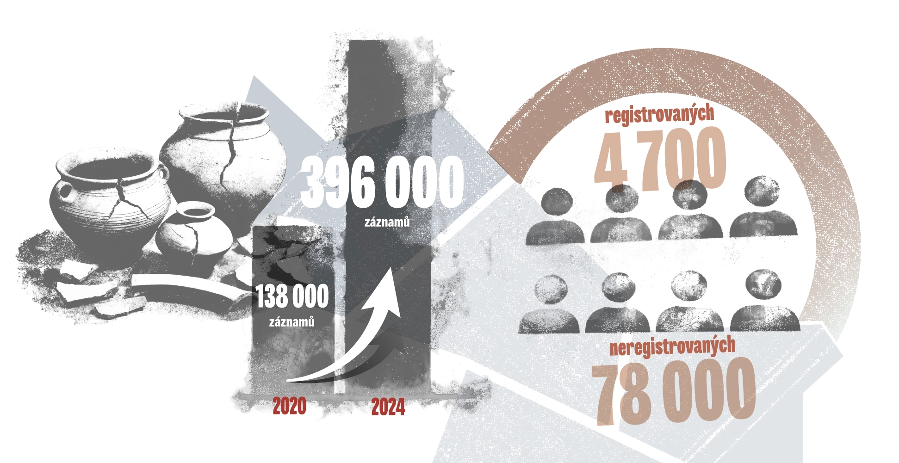
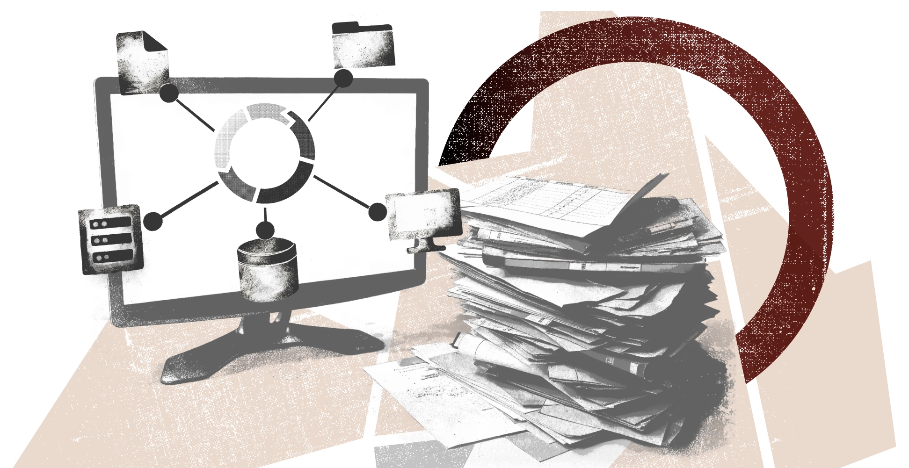
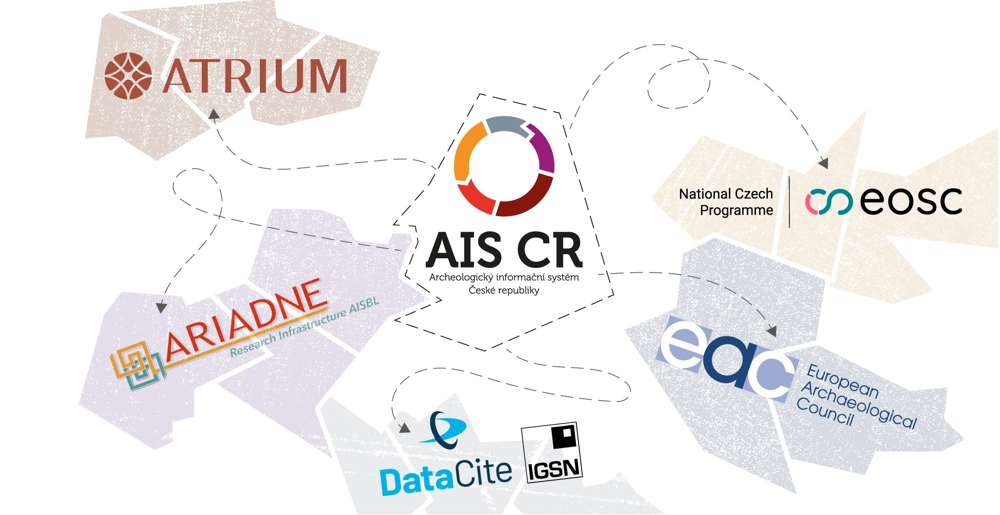
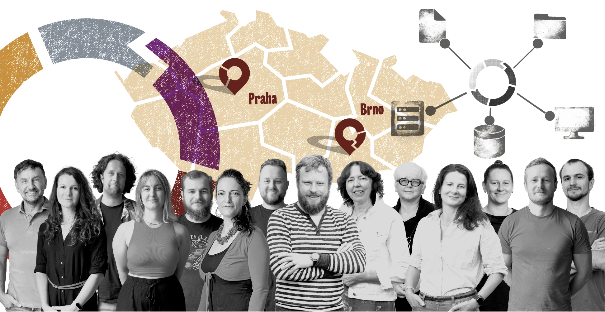

*Už potřetí jsme jako výzkumná infrastruktura obhajovali výsledky své práce. Nebyla to sice skutečná maturita, ale chvílemi jsme si tak trochu připadali. A výsledná známka? Pětka! Ale nás to netrápí. Naopak, máme obrovskou radost. Pět totiž v mezinárodním hodnocení výzkumných infrastruktur znamená Excellent – nejlepší možné hodnocení.*

O co vlastně šlo? AIS CR patří mezi [velké výzkumné infrastruktury České republiky](https://www.vyzkumne-infrastruktury.cz/cestovni-mapa-velkych-vyzkumnych-infrastruktur-cr/), jejichž činnost podporuje Ministerstvo školství, mládeže a tělovýchovy (MŠMT). Abychom mohli tuto podporu získávat i v dalších letech, musíme pravidelně představit a obhájit, co a jak děláme, kam jsme se posunuli a jestli máme smysluplné plány do budoucna.

Nad bilancováním, počítáním, shromažďováním podkladů a sepisováním evaluační zprávy jsme strávili nejeden zádumčivý podzimní večer roku 2025. Shrnout čtyři roky činnosti infrastruktury do stostránkového limitu totiž nebylo vůbec jednoduché.  Výslednou zprávu dostali k prostudování mezinárodní hodnotitelé a hodnotitelky. V horkém červnu 2026 jsme se pak setkali tváří v tvář s hodnoticím panelem.

A jak nás komise vidí tentokrát? Co ocenila a kde nám naopak doporučila začlenit nové perspektivy? Pojďme společně otevřít její závěrečnou zprávu, takzvaný Consensus Report, a podívat se, co se v ní píše.

Začněme větou, která pro nás po letech náročné práce v plném nasazení byla obrovskou satisfakcí:

*„AIS CR has become one of the foremost digital infrastructures for archaeology in Europe.“*

Tedy že se AIS CR stal jednou z předních digitálních infrastruktur pro archeologii v Evropě.

Nejvyšší známku jsme sice získali už při minulém hodnocení, ale tentokrát komise ocenila i to, jak výrazně jsme se od té doby posunuli.

> *AIS CR v číslech. V roce 2024 jsme měli téměř 4 700 registrovaných uživatelů a uživatelek, tedy skoro pětkrát více než v roce 2020. Naše online služby využívalo přibližně 78 000 lidí ročně. A počet archivovaných a zveřejněných záznamů vzrostl mezi lety 2020 a 2024 ze 138 000 na 396 000.*

## Co se dá stihnout za čtyři roky? Docela dost.

Při přípravě evaluační zprávy jsme sami s překvapením zjišťovali, kolik se toho za období 2021–2024 vlastně změnilo. Největší výzvou byla bezpochyby modernizace Archeologické mapy České republiky (AMČR), kterou jsme dokončili v roce 2024. A rozhodně nešlo jen o nový vzhled aplikace. Přestavěli jsme také její technologické zázemí, včetně digitálního repozitáře pro uchovávání archeologické dokumentace. Díky tomu dnes dokážeme lépe chránit uložená data, sledovat jejich původ a spravovat jednotlivé verze dokumentů. Zároveň jsme lépe připraveni na rozvoj, který se nyní naplno rozbíhá a je denně testován nástupem nástrojů podporovaných umělou inteligencí.

Vedle těchto velkých změn jsme se věnovali i méně viditelným, ale neméně důležitým věcem. V navazujícím rozvoji v roce 2025 jsme například zavedli trvalé identifikátory DOI a IGSN, které umožňují jednoznačně identifikovat archeologické záznamy, spolehlivě na ně odkazovat a propojovat je s dalšími daty. I tím uvádíme do praxe principy FAIR, aby data byla dohledatelná, dostupná, propojitelná a znovu využitelná. Také jsme tím začali včas plnit nároky, které na důvěryhodné repozitáře klade jak nová legislativa, tak dobré praxe prosazující se zejména skrze českou implementaci [EOSC](https://www.eosc.cz/). Více o způsobu zavedení trvalých identifikátorů do AMČR se můžete dočíst v našem článku [DOI v AMČR: digitální rodné číslo pro vaše data](https://www.aiscr.cz/blog/doi-v-amcr-digitalni-rodne-cislo/).

A pak jsou tu čísla. Na začátku roku 2020 obsahoval Digitální archiv AMČR přibližně 138 tisíc záznamů, na konci roku 2024 už jich bylo 396 tisíc. Takový nárůst se ale nestane sám od sebe. Za zpřístupněnou dokumentací stojí každodenní práce: příprava na digitalizaci, kontrola výsledků, vytváření a zpřesňování metadat nebo propojování souvisejících záznamů. To vše vyžaduje čas, trpělivost a odborné znalosti archeologů a archeoložek. Záznam po záznamu tak vzniká zdroj informací, který využívá celá archeologická komunita i veřejnost. Lidé, kteří za jeho vytvářením stojí, přitom zůstávají často v pozadí. Na rozdíl od autorů a autorek odborných článků nebývají jejich jména spojena s každým jednotlivým výsledkem, přesto z jejich práce denně těží další uživatelé a uživatelky.

Výrazně přibylo také lidí, kteří naše služby využívají - to je vidět i na násobném růstu nově registrovaných uživatelů. A to nejen z řad archeologů a archeoložek, ale i dalších profesí a široké veřejnosti. Vedle této často neviditelné práce ocenila komise také naši spolupráci s uživatelskou komunitou. Nové služby totiž nevznikají jen podle našich představ. Sbíráme připomínky, řešíme problémy z praxe a snažíme se nástroje přizpůsobovat skutečným potřebám archeologické komunity. Někdy jde o velké změny, jindy o drobnosti, které ale při každodenní práci dokážou ušetřit spoustu času.

A to všechno v podmínkách, které nebyly vždy jednoduché. V uplynulém období jsme totiž hospodařili přibližně se 70 % plánovaného rozpočtu, přestože jeho původní výši podpořila i hodnoticí komise při předchozí evaluaci. O to víc nás těší, že komise ocenila výrazný pokrok, kterého se nám podařilo dosáhnout i za těchto podmínek.

> *Od archivních dokumentů k propojeným datům. Výjimečnost AIS CR spočívá v tom, že propojuje evidenci archeologických výzkumů, správu a dlouhodobé uchovávání dokumentace i její zpřístupňování a další využití v jednom systému.*

## V čem jsme vlastně výjimeční?

Archeologický výzkum má jednu zvláštnost: při odkrývání archeologických situací je zároveň nevratně ničíme. Vedle samotných nálezů proto zůstává nenahraditelná dokumentace – fotografie, plány, kresby a další záznamy, díky nimž se k výsledkům výzkumu mohou vracet další generace. Nestačí je však jen někam uložit. Musíme zajistit, aby byly dlouhodobě dohledatelné, srozumitelné a znovu využitelné. A právě zde se dostáváme k jedné z předností AIS CR, kterou hodnoticí komise zvlášť vyzdvihla: jeho komplexnosti. AIS CR propojuje celý proces práce s archeologickými daty – od evidence plánovaného výzkumu přes dokumentaci terénních prací až po dlouhodobé uchovávání výsledků, jejich zpřístupňování a další využití.

Komise nás srovnávala s vybranými evropskými archeologickými infrastrukturami, jako je [ADS](https://archaeologydataservice.ac.uk/) či [DANS](https://dans.knaw.nl/en/archaeology/), a dospěla k závěru, který nás obzvlášť potěšil:

*„No benchmarked European repository does all of this.“*

Žádný ze srovnávaných evropských repozitářů tedy nepokrývá všechny tyto činnosti v takovém rozsahu.

Význam AIS CR však nekončí u odborného výzkumu. Komise mimořádně ocenila také zapojování veřejnosti, zejména prostřednictvím [Portálu amatérských spolupracovníků](https://amcr-info.aiscr.cz/amcr-pas/) (AMČR-PAS). Ten označila za v této části Evropy jedinečný příklad občanské vědy. Za jeho hlavní přínos přitom nepovažuje jen samotné technické řešení, ale především propojení právního, metodického a organizačního rámce, který umožňuje odpovědnou spolupráci amatérské komunity s profesionální archeologií.

Právě spojení všech těchto funkcí hodnoticí komise ve své zprávě ocenila takto: 

*„AIS CR is unique at every level and has no viable alternative.“*

Podle komise je tedy AIS CR jedinečný ve všech ohledech a nemá srovnatelnou alternativu.

> *Co konkrétně děláme v rámci mezinárodní spolupráce? V ARIADNE RI zpřístupňujeme česká archeologická data a podílíme se na rozvoji evropské infrastruktury. V projektu ATRIUM vyvíjíme nástroje umělé inteligence pro automatické zpracování dokumentů a fotografií. Prostřednictvím EOSC-CZ přispíváme k rozvoji národní infrastruktury pro výzkumná data, v EAC k evropským doporučením pro péči o archeologické dědictví a ve spolupráci s DataCite a IGSN k rozvoji standardů pro identifikaci a citování výzkumných dat a archeologických vzorků.*

## Z Česka do Evropy. A zpátky.

Archeologické dědictví se státními hranicemi příliš neřídí. A archeologická data by se jimi neměla nechat omezovat také. Chceme-li například zkoumat obchodní kontakty, migrace nebo proměny osídlení v minulosti, potřebujeme umět propojovat informace z různých zemí. Jenže to není tak jednoduché, když každá používá jiné databáze, pojmy a způsoby evidence.

Mezinárodní spolupráce patřila k oblastem, které hodnoticí komise ocenila mimořádně pozitivně. Ve své zprávě ji označila za výjimečnou a dodala:

*„European engagement is outstanding and considerably exceeds what would be expected of a national infrastructure in a specialised domain.“*

Jinými slovy, naše zapojení do evropských aktivit výrazně přesahuje to, co by se běžně očekávalo od národní infrastruktury zaměřené na jeden specializovaný obor.

A co konkrétně tím měla na mysli?

V evropské výzkumné infrastruktuře [ARIADNE RI](https://www.ariadne-research-infrastructure.eu/) nejen zpřístupňujeme česká archeologická data širší odborné komunitě, ale také se podílíme na vytváření společných pravidel pro jejich popisování, propojování a vyhledávání. Díky tomu mohou archeologové a archeoložky pracovat s daty napříč Evropou, i když původně vznikala v různých systémech a podle odlišných postupů.

Další oblastí je využití umělé inteligence. V mezinárodním projektu [ATRIUM](https://atrium-research.eu/) společně s evropskými partnery a partnerkami vyvíjíme postupy, jak automaticky získávat informace z rozsáhlých souborů historické dokumentace, jejichž obsah je dnes obtížně prohledatelný a využitelný. Učíme počítače rozpoznávat text ve starých dokumentech, vyhledávat v něm důležité informace, třídit archeologické fotografie a určovat, co je na nich zachyceno. Nejde přitom o to nahradit odbornou práci, ale usnadnit zpracování materiálů, na kterém bychom jinak pracovali desetiletí – my i další generace AIS CR.

Zapojení AIS CR do evropských iniciativ, včetně aktivit souvisejících s [EOSC](https://www.eosc.cz/), [EAC](https://www.europae-archaeologiae-consilium.org/) nebo [DataCite](https://igsn.github.io/archcop-metadata-profile/), nám zároveň umožňuje podílet se na utváření evropského prostředí pro správu a sdílení výzkumných dat. Do evropské spolupráce přinášíme také vlastní zkušenosti, odborné postupy a řešení, která pomáhají nastavovat společné standardy a rozvíjet provázanost a využitelnost archeologických dat. A zkušenosti, které při tom získáváme, se vracejí zpátky do našich služeb.

Hodnotící komise ocenila právě to, že se AIS CR z národní infrastruktury postupně stal aktivním partnerem evropské archeologie. Nejenže dokážeme naše data nabídnout ostatním, ale podílíme se také na vytváření prostředí, v němž je bude možné smysluplně využívat. A z toho nakonec těží i archeologická komunita v Česku.

> *Dva ústavy, jeden tým. Hodnoticí komise ocenila spolupráci Archeologických ústavů AV ČR v Brně a Praze, jejich společné řízení, jasné rozdělení odpovědností a jednotnou vizi rozvoje AIS CR.*

## A kde máme ještě domácí úkoly?

Skoro samé jedničky, tedy vlastně pětky, v jednotlivých okruzích evaluace by mohly vzbudit dojem, že máme hotovo. Jenže archeologická data stále přibývají, technologie se mění a s nimi i očekávání těch, kdo naše služby využívají. Hodnoticí komise nám proto vedle pochval předala také několik doporučení do dalších let.

Jedním z nich je získání mezinárodní certifikace [CoreTrustSeal](https://www.coretrustseal.org/) pro náš digitální repozitář. Ta ověřuje, zda je úložiště důvěryhodné a dokáže zajistit dlouhodobou správu a uchovávání dat. Nestačí totiž říkat, že dokumentaci bezpečně uchováváme. Musíme také umět nezávisle doložit, jak to děláme.

Další výzvou je rozvoj práce s prostorovými a 3D daty, kterých v archeologii rychle přibývá. Zatímco fotografie nebo textové dokumenty už umíme poměrně dobře archivovat a zpřístupňovat, prostorová a 3D data kladou specifické nároky na ukládání, popis i dlouhodobou využitelnost.

Komise nás také povzbudila k tomu, abychom lépe sledovali, jak se naše data dále využívají, a systematičtěji publikovali výsledky technického vývoje – například software, metodiky nebo nové postupy zpracování dokumentace. Smyslem otevřené vědy totiž není jen zpřístupnit data, ale umožnit ostatním stavět na tom, co už vzniklo.

A pak je tu úkol, který se do žádné aplikace nevejde: udržet a rozvíjet tým lidí, kteří za všemi těmito službami stojí. Komise to formulovala velmi jednoznačně:

*„Protect the team.“*

Chraňte svůj tým. Tohle doporučení nám mluví z duše. Víme totiž, kolik práce, zkušeností a vzájemné spolupráce se skrývá za každou novou funkcí i každým zpřístupněným záznamem. A že jsme toho tolik dokázali právě díky sehranému týmu, v němž se odborné znalosti a zkušenosti potkávají s lidskostí, vzájemným respektem a podporou. Právě takový tým a prostředí, ve kterém může dobře fungovat a dál se rozvíjet, považujeme za jeden ze základních předpokladů dlouhodobé udržitelnosti AIS CR.

## A co nás čeká dál?

Projít evaluací nebylo jednoduché. Po jejím úspěšném završení jsme si sice oddechli, ale teď přichází další napínavá část. V listopadu se výsledky hodnocení dostaly na jednání Rady pro výzkum, vývoj a inovace a následně budou předloženy vládě. Ta by měla v prosinci rozhodnout o financování výzkumných infrastruktur pro další období. Pevně věříme, že rozhodnutí o financování zohlední význam jednotlivých infrastruktur pro českou vědu i výsledky jejich mezinárodního hodnocení. Byl by to pro nás ten nejlepší vánoční dárek.

Výborné hodnocení je pro nás velkým povzbuzením, ale samo o sobě nám nezajistí podmínky pro uskutečnění všech dalších plánů. K tomu potřebujeme stabilní tým i dostatek prostředků. A samozřejmě také nadšení a chuť posouvat věci dál - ty nám rozhodně nechybějí.

Za výsledkem hodnocení ale nestojí jen současný tým AIS CR. Navazujeme na práci našich předchůdců a předchůdkyň i dlouhou tradici obou archeologických archivů. A bez organizací a lidí, kteří archeologická data vytvářejí, předávají, využívají a pomáhají nám služby zlepšovat, by AIS CR nebyl tím, čím je dnes. Poděkování proto patří celé archeologické komunitě, našim partnerským institucím i těm, kdo naši práci dlouhodobě podporují – zejména MŠMT a oběma archeologickým ústavům AV ČR.

Tak nám držte palce! Nebo vlastně – držte je i sobě. AIS CR totiž budujeme pro archeologickou komunitu i veřejnost, zkrátka pro všechny, kdo chtějí poznávat a chránit naše archeologické dědictví. A máme ještě spoustu nápadů a plánů!

## Shrnutí

- AIS CR získal v mezinárodním hodnocení výzkumných infrastruktur nejvyšší známku Excellent.

- Hodnoticí komise ocenila výrazný rozvoj infrastruktury v letech 2021–2024, zejména modernizaci AMČR, rozvoj Digitálního archivu a nárůst objemu zpřístupněných dat i počtu uživatelů.

- Za hlavní přednost AIS CR označila propojení celého životního cyklu archeologických dat: od evidence výzkumů přes dokumentaci až po dlouhodobé uchovávání a zpřístupňování.

- Vyzdvihla také zapojení veřejnosti prostřednictvím AMČR-PAS a nadstandardní mezinárodní spolupráci, zejména v rámci evropských výzkumných infrastruktur a projektů.

- Mezi doporučení pro další rozvoj patří získání certifikace CoreTrustSeal, zlepšení správy prostorových a 3D dat, sledování dalšího využívání dat a ochrana odborného týmu.

- O financování výzkumných infrastruktur pro další období má na základě výsledků hodnocení rozhodnout vláda v prosinci 2026.

## Chcete vědět víc?

- [Michael Prouza: Velké výzkumné infrastruktury jsou českou vstupenkou do nejlepší světové vědy](https://vedavyzkum.cz/rozhovory-a-osobnosti/rozhovory/michael-prouza-velke-vyzkumne-infrastruktury-jsou-ceskou-vstupenkou-do-nejlepsi-svetove-vedy)

- [Velké výzkumné infrastruktury stojí před nejistou budoucností](https://vedavyzkum.cz/analyzy/analyzy/velke-vyzkumne-infrastruktury-stoji-pred-nejistou-budoucnosti)
